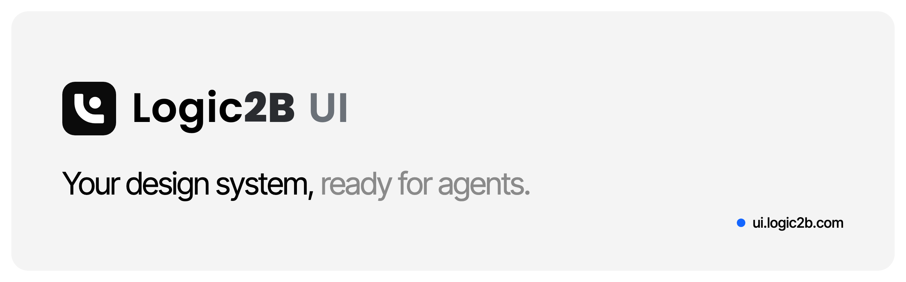

<p align="center">
  <a href="https://ui.logic2b.com">
    
  </a>
</p>

<p align="center">
  <a href="https://github.com/amariner/logic2b-ui/actions/workflows/ci.yml"></a>
  <a href="https://www.npmjs.com/package/logic2b"></a>
  <a href="https://www.npmjs.com/package/@logic2b/mcp"></a>
  <a href="./LICENSE"></a>
</p>

<p align="center">
  <a href="https://ui.logic2b.com">Website</a> ·
  <a href="https://ui.logic2b.com/docs">Documentation</a> ·
  <a href="https://ui.logic2b.com/docs/components">Components</a> ·
  <a href="https://ui.logic2b.com/create">Theme studio</a> ·
  <a href="./ROADMAP.md">Roadmap</a>
</p>

---

**Logic2B UI** is a shadcn/ui-compatible React component registry with
reproducible themes, install plans and tools for maintaining customized
interfaces. It is built for teams creating SaaS products, dashboards and
internal tools with coding agents — and for the people who review what those
agents ship.

The goal is a complete workflow: understand an existing project, compose real
components, verify their behavior and preserve local customizations through
later changes and upstream updates.

> **Status: public beta.** The CLI and MCP server ship on the npm `next`
> channel. See [RELEASING.md](./RELEASING.md) for the release policy and
> [ROADMAP.md](./ROADMAP.md) for what is shipped versus planned.

## Quick start

Add components to an existing React + Tailwind v4 project:

```bash
npx logic2b@next add button card dialog
```

Create a new app with a theme preset from the [studio](https://ui.logic2b.com/create):

```bash
npx logic2b@next init --template vite --starter marketing --preset <id>
```

Connect a coding agent to the remote MCP endpoint (streamable HTTP, nothing
to install):

```text
https://ui.logic2b.com/mcp
```

or run it locally with `npx -y @logic2b/mcp@next`. See the
[installation guide](https://ui.logic2b.com/docs/installation) and the
[MCP setup guide](https://ui.logic2b.com/docs/llms#mcp-server).

## Features

- **71 UI components plus blocks and charts** — React 19 + Tailwind v4,
  shadcn-compatible APIs, each component with a documented accessibility
  contract and an executable prop playground.
- **Reproducible themes** — the `/create` studio turns any theme into a single
  preset id that the site, CLI, MCP server and VS Code extension apply exactly,
  including its icon library. Eight curated presets ship in `/themes`.
- **Immutable, verified registry** — versioned manifests, content-addressed
  payloads and SHA-256 integrity checks on every read; per-item changelogs.
- **Built for agents** — MCP tools that return file writes instead of shell
  commands (`install_plan`, `scaffold_plan`, `apply_preset`, `lint_theme`,
  `list_presets`, …), `llms.txt`, Markdown versions of every docs page and
  copy-ready prompts on every install surface.
- **Maintenance, not just generation** — project inspection, managed agent
  rules, evidence-based static review, preconditioned incremental changes with
  recovery and browser verification of the consumer app (some of these are in
  the source ahead of npm publication; see [RELEASING.md](./RELEASING.md)).
- **Design tokens everywhere** — deterministic exports for Tokens Studio /
  Figma Variables, DTCG JSON, CSS, iOS Swift and Android resources.

## Repository layout

| Path | Description |
| --- | --- |
| [`packages/registry`](./packages/registry) | Component, block and chart sources; registry build, release history and integrity checks |
| [`packages/tokens`](./packages/tokens) | Theme presets, token exports, contrast audit and theme linting |
| [`packages/scaffold`](./packages/scaffold) | Shared scaffold and composition core used by the CLI and MCP |
| [`packages/review`](./packages/review) | Non-executing TSX/JSX static review engine |
| [`packages/cli`](./packages/cli) | `logic2b` CLI — `add`, `init`, `list`, `diff`, `status`, `update`, `rules`, `review`, `change`, `verify`, `compose` |
| [`packages/mcp`](./packages/mcp) | MCP server (stdio and HTTP) exposing the registry to coding agents |
| [`packages/vscode`](./packages/vscode) | VS Code extension preview |
| [`apps/web`](./apps/web) | Website, bilingual docs (EN/ES), theme studio and `/mcp` route — Astro on Cloudflare Workers |
| [`benchmarks`](./benchmarks) | Framework lab and agent benchmark protocol with archived results |
| [`skills`](./skills) | Agent skill distributed with the MCP package |
| [`docs`](./docs) | Implementation guides, execution queue and project history |

## Development

Requirements: Node.js 22.12+ and pnpm 11 (pinned through `packageManager`).

```bash
pnpm install --frozen-lockfile
pnpm --dir packages/registry build      # generate the registry payloads
pnpm --filter @logic2b/web dev          # site on http://localhost:4321
pnpm build                              # full build
pnpm lint && pnpm test                  # type checks, registry integrity, unit tests
```

Additional gates:

```bash
pnpm test:release-artifacts                  # pack and smoke-test CLI + MCP tarballs
pnpm --filter @logic2b/mcp test:scaffolds    # install and build generated starters
pnpm --filter @logic2b/web test:e2e          # axe + visual suites (after build)
pnpm --filter @logic2b/web test:budgets      # bundle and payload size budgets
pnpm package:vscode                          # build the VS Code extension VSIX
```

## Deployment

The site deploys to **Cloudflare Workers** through `@astrojs/cloudflare` and
`apps/web/wrangler.jsonc`. The build needs no secrets.

```bash
cd apps/web && npx wrangler deploy
```

To deploy elsewhere, swap the adapter in `apps/web/astro.config.mjs`.

## Contributing

Contributions are welcome. Read [CONTRIBUTING.md](./CONTRIBUTING.md) and the
[Code of Conduct](./CODE_OF_CONDUCT.md) before opening a pull request. Commits
follow [Conventional Commits](https://www.conventionalcommits.org). Coding
agents start with [AGENTS.md](./AGENTS.md); visual rules live in
[DESIGN.md](./DESIGN.md). Earlier milestones are archived in
[docs/roadmap-history.md](./docs/roadmap-history.md).

Report vulnerabilities privately as described in [SECURITY.md](./SECURITY.md).

## License

[MIT](./LICENSE) © Andreu Mariner — [Logic2B](https://logic2b.com).
Third-party notices are listed in [THIRD-PARTY-LICENSES.md](./THIRD-PARTY-LICENSES.md).
